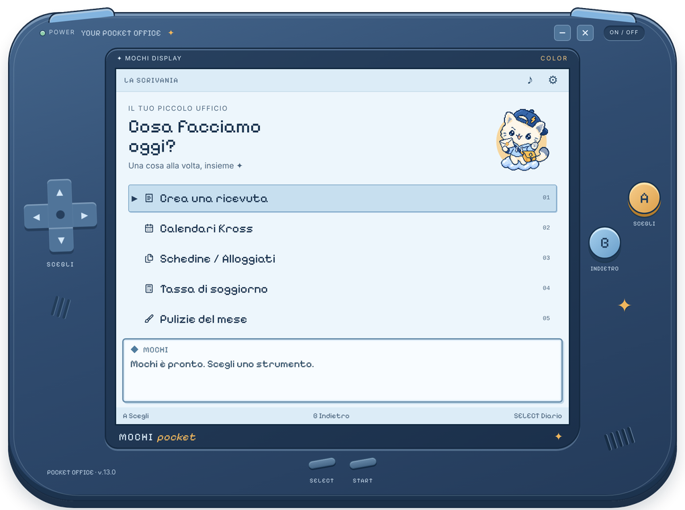
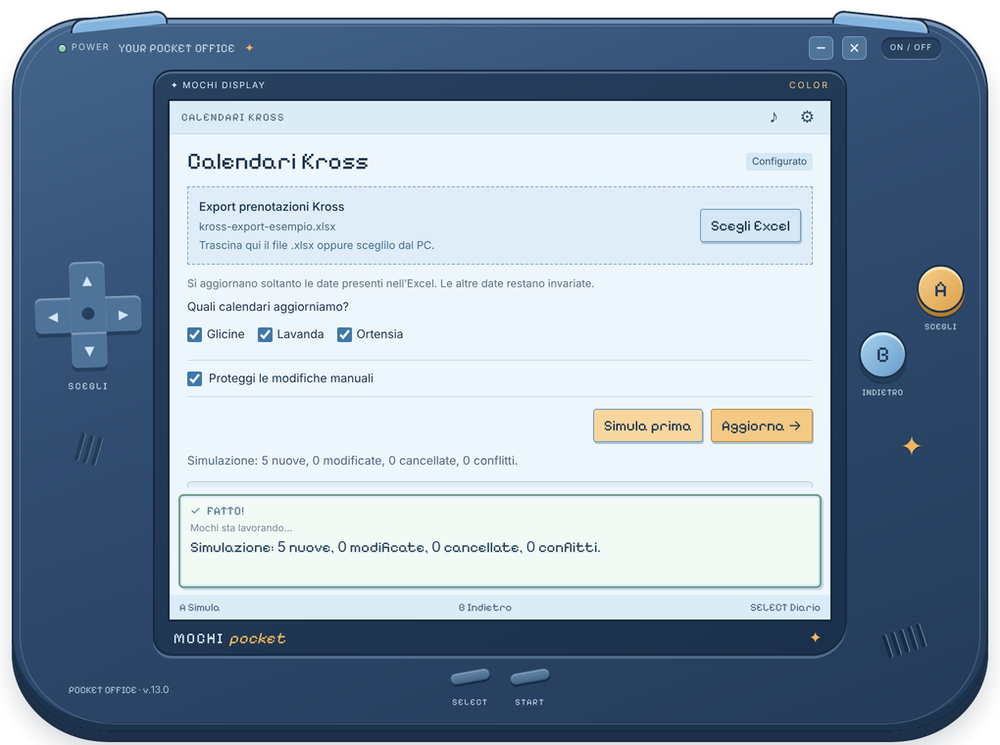
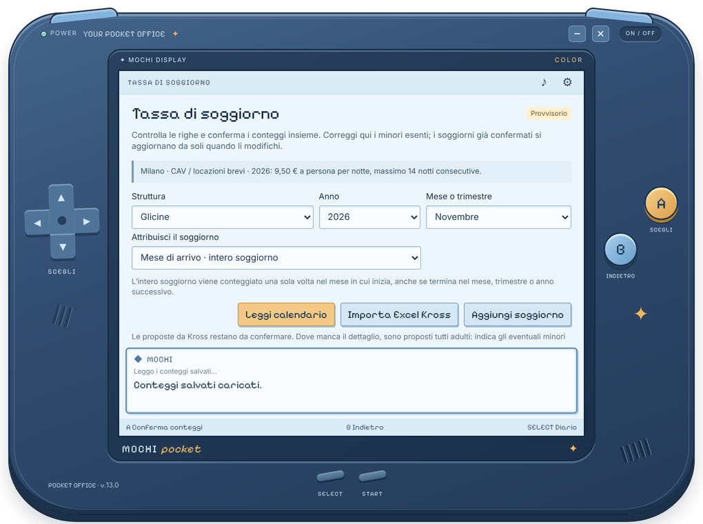

<p align="center">
  
</p>

<h1 align="center">Mochi Pocket</h1>

<p align="center">
  <b>A pocket office for short-term rental hosts.</b><br>
  Guest receipts, booking calendars, police registration receipts, tourist tax and cleanings,<br>
  in one small desktop app that looks like a handheld console.
</p>

<p align="center">
  <a href="LEGGIMI.md"><b>Guida alla configurazione (italiano)</b></a>
  &nbsp;·&nbsp;
  <a href="#what-it-does">What it does</a>
  &nbsp;·&nbsp;
  <a href="#how-it-is-built">How it is built</a>
</p>

<p align="center">
  <a href="https://github.com/GiovanniBishara/Mochi-Pocket/actions/workflows/ci.yml"></a>
  
  
  
</p>

<p align="center">
  
</p>

Hosts with a few apartments repeat the same chores every month: copy bookings
from the channel manager into each apartment's calendar, write receipts, download
the police registration receipts, count the tourist tax, check the cleaning
company's bill. Mochi does them in a few clicks, locally, and shows what it is
about to change before changing it.

*The interface is in Italian, because the rules it implements (Alloggiati Web,
Milan's tourist tax) are Italian. All screenshots use invented properties and guests.*

## What it does

| | |
| --- | --- |
| **Guest receipt** | A PDF receipt per stay, numbered progressively per year, with the right issuer for each property. *Compila dal calendario* reads the stay (name, nights) from the calendar; nothing is overwritten. |
| **Kross calendars** | Takes the Excel export of the [Kross](https://www.krossbooking.com) channel manager and writes each guest into the nights of the right apartment's calendar (Excel or Google Sheets). Dry run first; only the dates in the export are touched; manual edits are protected; conflicts and cancellations are shown, never resolved silently. |
| **Alloggiati Web** | Downloads the official PDF receipts of the guest registrations sent to the Italian police, through the Alloggiati web service, and files them per apartment. Credentials are encrypted with Windows DPAPI. |
| **Tourist tax** | Counts arrivals, nights and exempt guests per month or quarter from the calendars and Kross data, lets you confirm them, and exports a printable report. |
| **Cleanings** | One cleaning per check-out, per apartment and month, to check against the cleaning company's invoice. |

<p align="center">
  
  
</p>

## How it is built

```
app/
├── main.cjs, preload.cjs      Electron: window, IPC bridge with named operations only
├── service.cjs                coordinator: one operation at a time, activity log, adapters
├── *-source.cjs, kross.cjs …  adapters: spawn the engines, validate every JSON answer, timeouts
├── tourist-tax.cjs            tax rules, row identity, confirmations, atomic persistence
├── shared/                    pure rules shared by the interface and the backend
└── ui/                        the console: one controller per screen, no network access
engines/
├── kross/codice/              Node + Python engine: read the export, plan, write calendars
│                              (Excel: byte-preserving XML patch; Google: Sheets API, OAuth PKCE)
└── alloggiati/                PowerShell SOAP client for the Alloggiati web service, DPAPI credentials
```

Decisions worth mentioning:

- **Plan, then write.** Every calendar change is computed as a plan first (the dry run is the same code path), then written with optimistic checks: if a cell changed since it was read, the write stops.
- **Excel files are patched, not re-saved.** Only the guest cells change; `preserve_xlsx.py` proves that every other byte of the archive (styles, formulas, cached values) is identical before replacing the file.
- **No property lives in the code.** Apartments, calendars and issuers come from `config.json` and `receipt-profiles.json` outside the program folder, so the code can be published and every host configures their own.
- **Locked-down renderer.** `contextIsolation`, `sandbox`, no `nodeIntegration`, a CSP, navigation and permission requests denied; the interface can only call named operations, never read files or run commands.
- **Secrets stay on the machine.** Google access uses OAuth with PKCE on a loopback port; Alloggiati credentials are DPAPI-encrypted for the current Windows user; error messages never include credentials or stderr.
- **No personal data in the repository, enforced.** `scripts/privacy-check.mjs` fails CI on tax codes, IBANs, e-mails, phone numbers, ID numbers, Google tokens and personal paths, plus a private word list kept in a CI secret.

More detail (in Italian) in [ARCHITETTURA.md](ARCHITETTURA.md).

## Try it

Windows 10/11, [Python 3.10+](https://www.python.org/downloads/) and [Node.js 20+](https://nodejs.org):

```powershell
git clone https://github.com/GiovanniBishara/Mochi-Pocket.git
cd Mochi-Pocket
npm install
pip install -r requirements.txt
npm start
```

`examples/` holds three invented apartments and an invented Kross export, so the
calendar import can be tried in two minutes. The [setup guide](LEGGIMI.md)
covers your own properties, Google Sheets, receipts and Alloggiati Web.

## Development

```powershell
npm test                              # Kross engine end to end on examples/, selection rules, privacy check
npm run privacy                       # scan the repository for personal data
node scripts/demo-browser.cjs shots   # real backend + real UI in Chromium, no Electron (screenshots)
```

## Credits

Pixel font [Pixelify Sans](https://fonts.google.com/specimen/Pixelify+Sans) (OFL), icons [Lucide](https://lucide.dev) (ISC).
The Mochi mascot was created for this app (AI-assisted illustration).
Not affiliated with Kross, the Italian State Police or the City of Milan.
